# 🧠 DRIMA-Py — Uma Reimplementação Moderna do Modelo DRIMA em Python

<p align="center">
  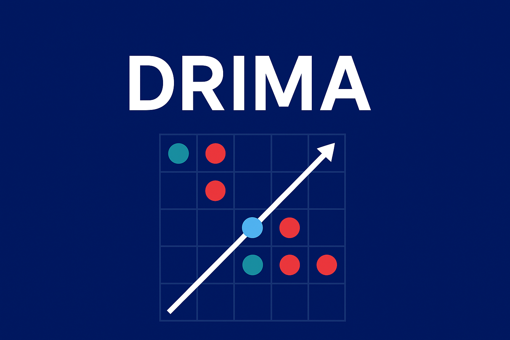
</p>

> **DRIMA-Py** é uma reimplementação moderna, aberta e extensível do modelo  
> **DRIMA – Dynamics of Reactive Interacting Multi-Agent**, originalmente desenvolvido em Mathematica.  
> Este projeto traz o modelo para Python 3.10 com uma arquitetura modular e visualização interativa.

---

# 📌 Sumário
- [Visão Geral](#visão-geral)
- [Motivação e Objetivos](#motivação-e-objetivos)
- [Funcionalidades](#funcionalidades)
- [Demonstração](#demonstração)
- [Instalação](#instalação)
- [Como Executar](#como-executar)
- [Estrutura do Projeto](#estrutura-do-projeto)
- [Conceitos do Modelo](#conceitos-do-modelo)
- [Exemplo de Uso](#exemplo-de-uso)
- [Roadmap](#roadmap)
- [Contribuindo](#contribuindo)
- [Autores](#autores)
- [Licença](#licença)

---

# 📘 Visão Geral

O **DRIMA-Py** é um simulador multiagente baseado no modelo **DRIMA**, proposto por Oliveira (2010).  
O sistema representa agentes reativos em uma grade bidimensional que interagem localmente, alterando probabilidades de movimento e produzindo comportamentos coletivos emergentes.

A versão original foi desenvolvida em **Mathematica**, uma linguagem funcional e proprietária, o que limita acessibilidade, reprodutibilidade e extensibilidade.

Esta reimplementação em **Python 3.10** visa democratizar o acesso ao modelo, tornando-o:

✔ aberto  
✔ modular  
✔ explicável  
✔ fácil de estender  
✔ adequado para ensino e pesquisa  

---

# 🎯 Motivação e Objetivos

### 🔹 1. Reproduzir o DRIMA original  
Mantendo a dinâmica entre agentes determinísticos (D) e reativos (R).

### 🔹 2. Criar uma implementação acessível e moderna  
Com uso de Python, Programação Orientada a Objetos, interface gráfica e formatos abertos.

### 🔹 3. Permitir aplicações práticas  
Incluindo simulações sociais, mercado, difusão e vida artificial.

---

# ⚙️ Funcionalidades

- Ambiente bidimensional toroidal  
- Agentes determinísticos (D) e reativos (R)  
- Interações locais que alteram probabilidades  
- Histórico completo da simulação  
- Visualização interativa (CustomTkinter)  
- Salvamento e carregamento em `.json.gz`  
- Gráficos individuais de probabilidade  

---

# 🖼️ Demonstração
<p align="center">
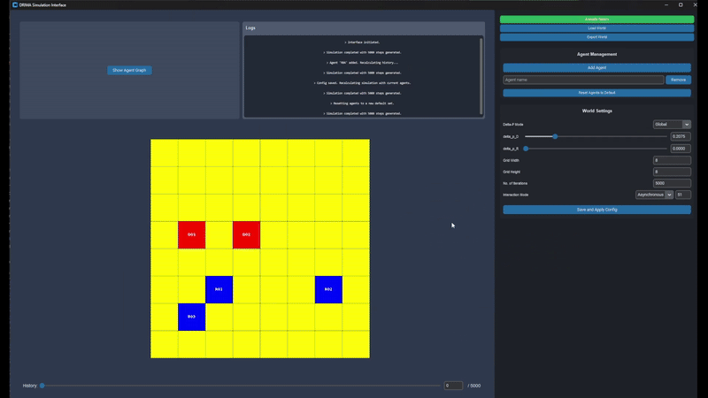
</p>

## Interface Principal
<p align="center">
  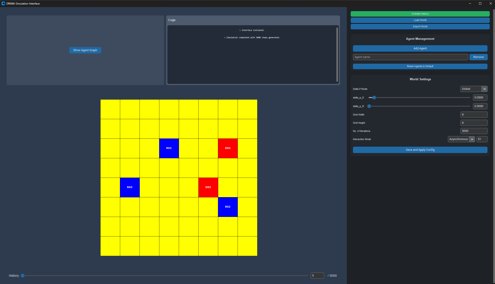
</p>


A nossa interface gráfica está sendo dividida em duas seções principais:

- Painel de Controle (painel da direita).
- Área de Visualização (painel da esquerda).

## Painel de Controle — Botões

<p align="center">
  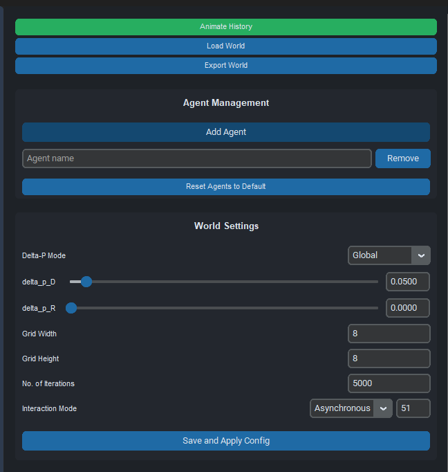
</p>

---

**Animate History** (▶️ / ⏸️)  
- **O que faz:** inicia ou pausa a simulação em tempo real.
- **Efeito esperado:** começa/para o loop de atualização e atualiza o botão de acordo.

---

**Load World** (📂)  
- **O que faz:** carrega um arquivo `.json.gz` com um mundo previamente salvo.
- **Efeito esperado:** substitui o mundo atual pelo conteúdo do arquivo e atualiza a interface.

---

**Export World** (💾)  
- **O que faz:** salva o estado atual em um arquivo `.json.gz`.
- **Efeito esperado:** gera arquivo exportável com histórico e parâmetros.

---

**Add Agent** (➕)  
- **O que faz:** abre diálogo para criar um agente (tipo, posição, probabilidade).
- **Efeito esperado:** insere agente no mundo e atualiza visualização.

<p align="center">
  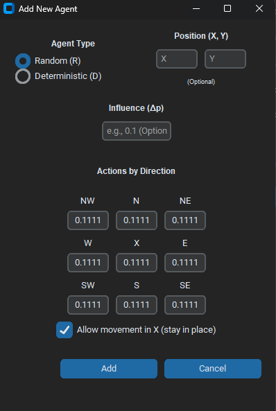
</p>

## Caixa de Diálogo \- Criar Agente

- **Tipo do agente**  
  - Controle: `Radio` / `Select` para escolher `D` (determinístico) ou `R` (reativo). Define comportamento e se probabilidades são mutáveis.

- **Posição na grade**  
  - Campos numéricos `X` / `Y` ou opção de clicar na visualização. Coordenadas em grade toroidal.

- **Raio de influência**  
  - `Slider` / campo numérico que determina alcance (distância) para vizinhança.

- **Rosa dos ventos (probabilidades de movimento)**  
  - Interface com 8 direções (N, NE, E, SE, S, SW, W, NW) \+ opcional `Parado`.

- **Permitir ficar parado**  
  - `Checkbox` que habilita/desabilita a opção `Parado`; quando marcada, o valor de `Parado` entra na soma das probabilidades.

- **Validações e correções**  
  - Exibe soma atual e aviso se a soma das probabilidades for maior ou menor que 1.  
  - Se soma \< 1:  mensagem para preencher o restante, assim distribui o restante igualmente entre as direções selecionadas (ou adiciona ao `Parado`, se aplicável).
  - `Adicionar` pode ficar desabilitado até que a soma seja corrigida ou normalizada.

- **Ações**  
  - **Adicionar** — cria o agente com parâmetros validados.  
  - **Cancelar** — fecha sem criar.

---

**Remove** (🗑️)
- **O que faz:** remove o agente selecionado.
- **Efeito esperado:** remove o agente do mundo, atualiza a visualização e grava o novo estado no histórico.

---

**Reset Agents to Default** (🔄)  
- **O que faz:** reseta o mundo para um estado inicial aleatório pré-definido.
- **Efeito esperado:** limpa histórico corrente e restaura posição/probabilidades pré-definidas.

---

**Delta_p: Local / Global** (🔬 / 🌐)  
- **O que faz:** seleciona se o Δp usado nas interações é local (do influenciador) ou global (parâmetros do mundo).
- **Efeito esperado:** muda parâmetro usado por `InteractionHandler`.

---

**Delta_p Sliders** (🔧)
- **O que faz:** ajusta os valores de Δp determinístico e estocástico via barras deslizantes.
- **Efeito esperado:** altera os valores usados por `InteractionHandler` em tempo real; afeta interações subsequentes.

---

**Grid Size** (📐)
- **O que faz:** campos numéricos para definir largura e altura da grade toroidal.
- **Efeito esperado:** redimensiona a grade; ao aplicar, reposiciona agentes ou distribui conforme a opção escolhida.

---

**Iterations Count** (#️⃣)
- **O que faz:** campo para definir o número de iterações a executar.
- **Efeito esperado:** controla quantas iterações a história terá.

---

**Alternar Modo (Síncrono / Assíncrono)** (🔁)  
- **O que faz:** muda a forma de atualização entre síncrona e assíncrona.
- **Efeito esperado:** altera como as rotinas de update são executadas.

---

**Save \& Apply Configurations** (💾✔️)
- **O que faz:** salva as configurações atuais (Δp, tamanho da grade, iterações, etc.) e aplica ao mundo.
- **Efeito esperado:** grava as configurações em arquivo de preferências e atualiza o estado corrente da interface/aplicação.

### Área de Visualização
<p align="center">
  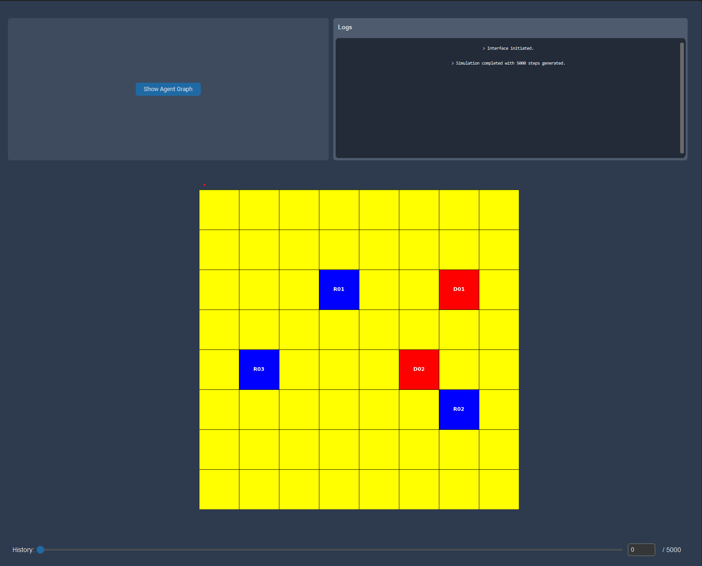
</p>

#### Logs
<p align="center">
  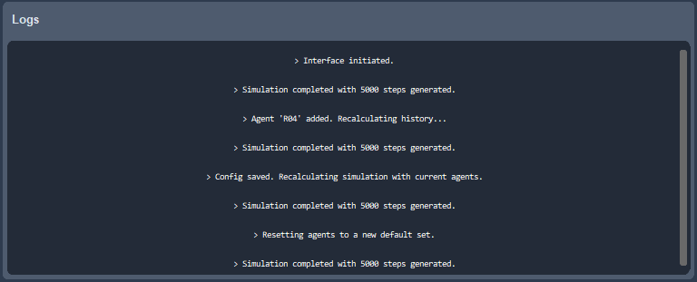


- **O que mostra:** histórico textual de eventos relevantes — criação/remoção de agentes, colisões, alterações de probabilidade, salvamentos e erros.   
- **Efeito esperado:** fornece rastreabilidade das ações da simulação e ajuda na depuração.

#### Animação / História

<p align="center">
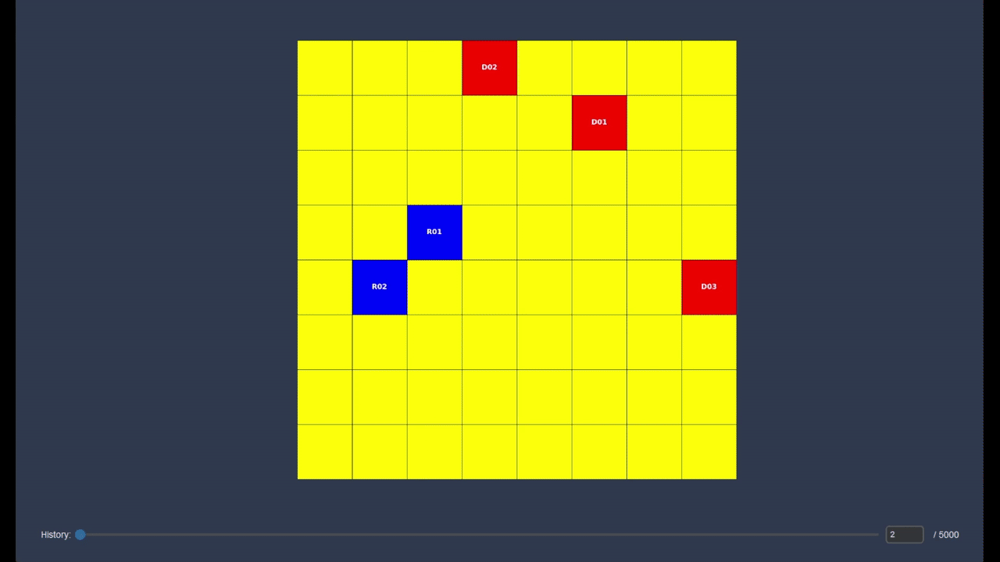
</p>

- **O que mostra:** visualização do mundo por iteração (cada iteração = um `mundo` do histórico).  
- **Controles:** `Slider` para escolher a iteração o momento da história, caixa de texto para passar manualmente o momento da história `t = X / N`.  
- **Comportamento:** mover o `Slider` atualiza a visualização; `Play` anima o `Slider`; interação manual pausa a reprodução.

#### Gerar Gráficos \- Janela de Filtro
<p align="center">
  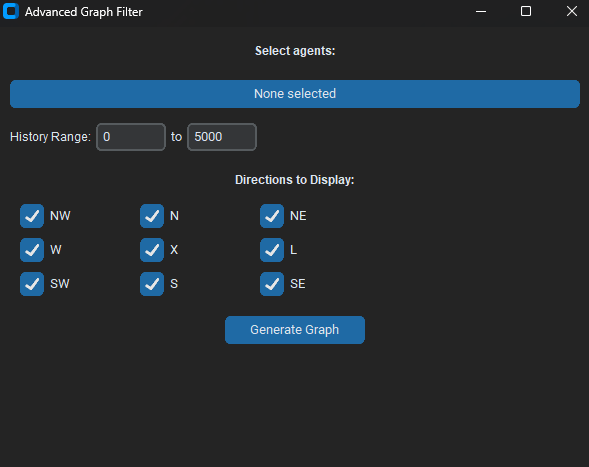
</p>

- **O que abre:** modal para selecionar as séries a serem desenhadas.  
- **Controles na janela:**  
  - `Multi-select de Agentes` — escolher agentes individuais ou grupos.  
  - `Intervalo de iterações` — campos `from` / `to` ou `range-slider`.  
  - `Direções` — checkboxes: `N`, `NE`, `E`, `SE`, `S`, `SW`, `W`, `NW` e opção `Parado`.
  - Ações: `Aplicar`, `Cancelar`, `Exportar (CSV)`.
- **Efeito esperado:** ao aplicar, abre a janela de gráficos com as séries filtradas; permite salvar uma imagem com todos gráficos selecionados.

---

# 💻 Instalação

```bash
git clone https://github.com/SEU_USUARIO/drima-py.git
cd drima-py
```

Ambiente virtual:

```bash
python3.10 -m venv venv
source venv/bin/activate
# ou no Windows
venv\Scripts\activate
```

Instalar dependências:

```bash
pip install -r requirements.txt
```

---

# ▶️ Como Executar

```bash
python main.py
```

---

# 🧱 Estrutura do Projeto

# Estrutura do projeto

- `DRIMA_py/`
  - `main.py`
  - `drima.json`
  - `requirements.txt`
  - `assets/`
  - `imagens/`
  - `configuracoes/`
  - `projeto/`
    - `AgentSpawner.py`
    - `FileHandler.py`
    - `GraphVisualizer.py`
    - `Interacoes.py`
    - `InterfaceTeste.py`
    - `Movimento.py`
    - `Representacao.py`
    - `WorldUpdater.py`
    - `WorldVisualizer.py`

---

# 🔍 Conceitos do Modelo

### **Agentes Determinísticos (D)**
- Probabilidades fixas  
- Funcionam como atratores  

### **Agentes Reativos (R)**
- Probabilidades mutáveis  
- Sofrem influência nas interações  

### **Interações**
- Ocorrem quando agentes colidem  
- Alteram apenas agentes R  
- Dependem de Δp determinístico e estocástico  

### **História**
- Cada iteração gera um “mundo”
- Todos os mundos são armazenados

---

## 🥤 Exemplo Prático: Competição entre duas marcas concorrentes

Para demonstrar o uso do DRIMA-Py, foi construído um cenário simples de **competição entre duas marcas**, representadas como forças opostas que influenciam consumidores.

- O exemplo se encontra nesse path do projeto caso quieram testar:
  [`configuracoes/conf_exemplo_uso/conf_coca_pepsi.gz`](configuracoes/conf_exemplo_uso/conf_coca_pepsi.gz)

### 🔹 Modelagem
- **Agentes Determinísticos (D):** representam as campanhas das marcas.  
  - Marca L → influencia movimento para o Leste  
  - Marca N → influencia movimento para o Norte  
- **Agentes Reativos (R):** representam consumidores, que iniciam com comportamento aleatório e podem ser influenciados.

### 🔹 Dinâmica
1. A simulação inicia com agentes D posicionados na grade.
2. Consumidores (R) movem-se aleatoriamente.
3. Quando um consumidor encontra um agente determinístico:
   - Sua probabilidade de movimento é alterada.
   - Ele passa a “preferir” a direção associada àquela marca.
4. Ao longo das iterações, observamos:
   - **Dispersão**, se as forças forem fracas ou equilibradas.  
   - **Convergência**, se uma marca exercer influência mais forte.

### 🔹 Resultado Esperado
- O modelo mostra como **pequenas influências locais** (encontros entre agentes) podem produzir:
  - preferência coletiva,
  - polarização,
  - ou um mercado indeciso.
- O comportamento emergente depende dos parâmetros das campanhas e da intensidade das interações.

Este exemplo demonstra o potencial do DRIMA-Py para simular dinâmicas sociais e de mercado de forma simples e exploratória.

<p align="center">
  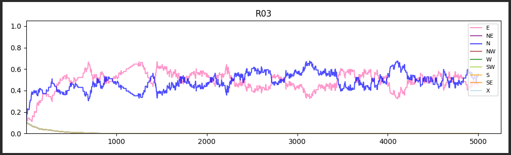
</p>

<p align="center">
  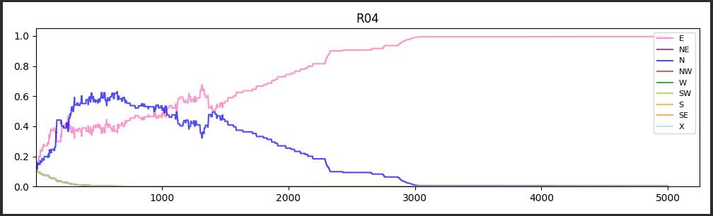
</p>

Com esse gráficos é possível observar essas tendências, tanto de indecisão desse mercado como a de convergência, sendo que no primeiro gráfico temos o agente R não convergindo para nenhuma direção específica, enquanto no segundo gráfico temos o agente R convergindo para a direção Leste, influenciado pelo agente D posicionado nessa direção.

---

# 🗺️ Roadmap

### ✔ Concluído
- Reimplementação completa  
- Interface gráfica  
- Histórico de estados  
- Salvamento em JSON.gz  

### 🚧 Futuro
- Métricas de convergência  
- Novos tipos de agentes  
- Automação de experimentos  
- Versão web  

---

# 🤝 Contribuindo

Contribuições são bem-vindas!  
Envie *Issues* e *Pull Requests*.

---

# 👨‍💻 Autores

**Mateus Kenzo Iochimoto**  
📧 [mateus.iochimoto@gmail.com](mailto:mateus.iochimoto@gmail.com)   
🔗  [Linkedin Mateus Kenzo Iochimoto](https://www.linkedin.com/in/mateus-kenzo-iochimoto/)  
🐙  [GitHub MateusKen](https://github.com/MateusKen  )

---

**Gabriel Gonzaga Chung**  
📧 [gabrielgchung@gmail.com](mailto:gabrielgchung@gmail.com)  
🔗 [LinkedIn Gabriel Gonzaga Chung](https://www.linkedin.com/in/gabriel-chung-757822297)  
🐙 [GitHub gabrielc231](https://github.com/gabrielc231)

---

**Igor Benites Moura**  
📧 [contato.igorbenites@gmail.com](mailto:contato.igorbenites@gmail.com)  
🔗 [LinkedIn Igor Benites Moura](https://www.linkedin.com/in/igor-benites-moura?utm_source=share&utm_campaign=share_via&utm_content=profile&utm_medium=android_app)  
🐙 [GitHub Darkyie](https://github.com/Darkyie)
