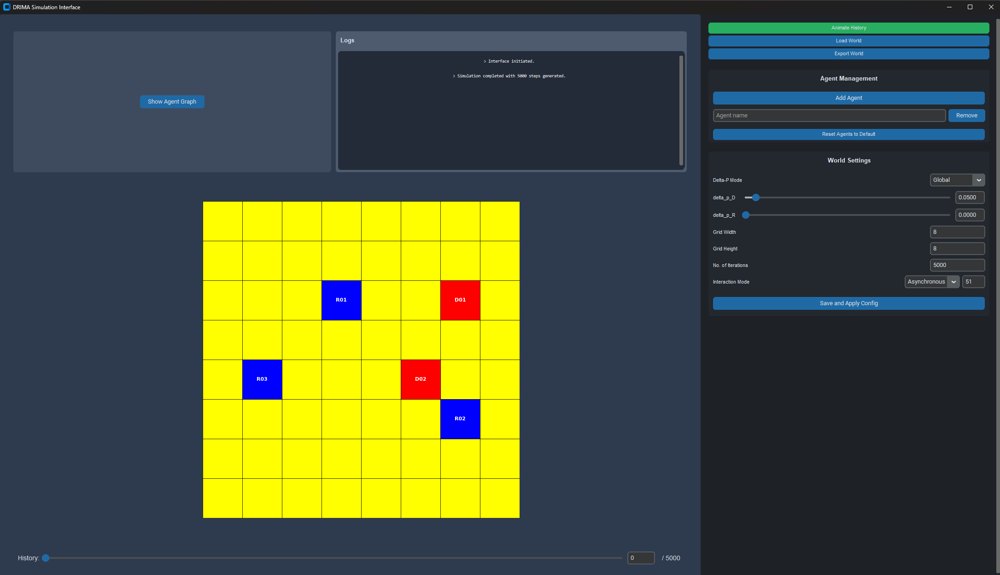
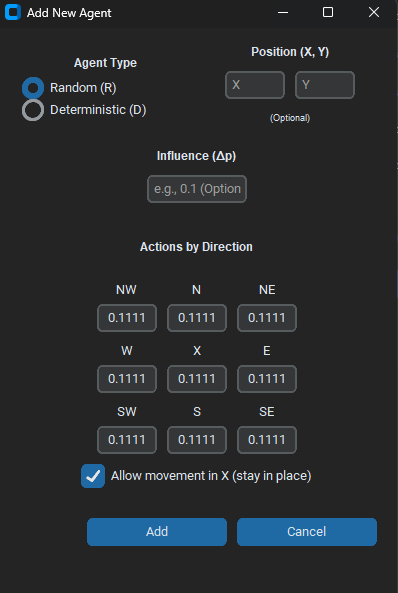
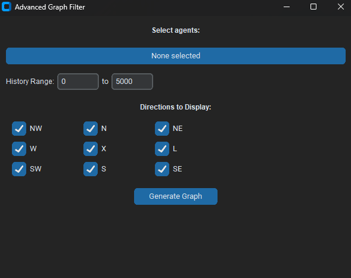
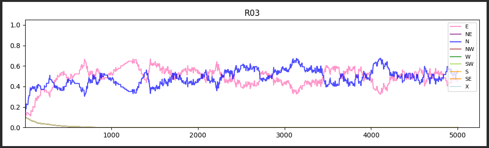

# Documentação Técnica: Simulador DRIMA

**Dynamics of Randomly Interacting Moving Agents**

Igor Benites Moura, Gabriel Gonzaga Chung e Mateus Kenzo Iochimoto
Faculdade de Computação e Informática (FCI), Universidade Presbiteriana Mackenzie, São Paulo, SP – Brasil

> Esta é a versão atualizada da documentação técnica. A versão original em PDF, de 17 de novembro de 2025, continua em [`DOCUMENTACAO_TECNICA_DRIMA.pdf`](../DOCUMENTACAO_TECNICA_DRIMA.pdf).
>
> **O que mudou em relação ao PDF:** Δp local por agente e seletor Global/Local; modo assíncrono com sub-iterações configuráveis; gráficos de vários agentes com exportação de imagem; formato de arquivo `.json.gz` (o PDF citava `.zip`); pasta `projeto/` (o PDF citava `project/`); novos módulos `WorldVisualizer.py` e `Normalizacao.py`.

## Sumário

1. [Visão geral do projeto](#1-visão-geral-do-projeto)
2. [Guia de instalação e execução](#2-guia-de-instalação-e-execução)
3. [Manual do usuário (interface gráfica)](#3-manual-do-usuário-interface-gráfica)
4. [Modelo de simulação](#4-modelo-de-simulação)
5. [Arquitetura do software](#5-arquitetura-do-software)
6. [Formato dos arquivos](#6-formato-dos-arquivos)

---

## 1. Visão geral do projeto

O Simulador DRIMA é uma aplicação para modelar, executar e analisar simulações de sistemas multiagente. O foco é estudar a **evolução do comportamento** e a **propagação de influência** em uma população de agentes com regras dinâmicas.

### 1.1 Componentes principais

- **Agentes Determinísticos (D):** agentes "teimosos" ou "influenciadores", com padrão de movimento fixo que nunca muda. Sempre se movem na direção de maior probabilidade.
- **Agentes Randômicos (R):** agentes "influenciáveis" ou "indecisos". O padrão de movimento é uma distribuição de probabilidade alterada pela influência dos vizinhos, e a direção de cada passo é sorteada segundo essa distribuição.

### 1.2 Tecnologias utilizadas

| Item | Tecnologia |
| --- | --- |
| Linguagem | Python 3.10+ |
| Interface gráfica | CustomTkinter |
| Visualização de dados | Matplotlib (e Pillow para exibir/exportar os gráficos) |
| Formato de dados | JSON |
| Compressão | gzip (`.json.gz`) |

---

## 2. Guia de instalação e execução

### 2.1 Pré-requisitos

- Python 3.10 ou mais recente
- `pip`

### 2.2 Instalação

```bash
git clone https://github.com/MateusKen/DRIMA_py.git
cd DRIMA_py
pip install -r requirements.txt
```

### 2.3 Estrutura de arquivos

Os `import`s dependem desta estrutura; execute sempre a partir da raiz.

```
DRIMA_py/
├── main.py              # ponto de entrada (interface gráfica)
├── drima.json           # configuração padrão
├── requirements.txt
├── configuracoes/       # mundos salvos e exemplos
├── assets/, imagens/    # imagens da documentação
├── docs/                # esta documentação
└── projeto/
    ├── __init__.py
    ├── Representacao.py
    ├── AgentSpawner.py
    ├── Interacoes.py
    ├── Movimento.py
    ├── Normalizacao.py
    ├── WorldUpdater.py
    ├── WorldVisualizer.py
    ├── GraphVisualizer.py
    ├── FileHandler.py
    └── InterfaceTeste.py
```

### 2.4 Execução

```bash
python main.py
```

A janela *DRIMA Simulation Interface* é aberta com um conjunto inicial de agentes aleatórios, e a história completa da simulação é calculada em seguida.

---

## 3. Manual do usuário (interface gráfica)

A interface tem dois painéis: o **Painel Funcional** (esquerda), com a visualização, e o **Painel de Controle** (direita), com a configuração.



### 3.1 Painel Funcional (visualização)

- **Visualização da simulação:** grade onde o estado da iteração atual é desenhado. Agentes D aparecem em vermelho e agentes R em azul.
- **Controle da história (barra inferior):** slider e caixa de texto para ir a uma iteração específica; o rótulo `/ N` mostra o total de iterações.
- **Show Agent Graph:** abre a janela *Advanced Graph Filter* (seção 3.4).
- **Logs:** console com o status do sistema, confirmações de ações (ex.: agente adicionado) e mensagens de erro.

### 3.2 Painel de Controle (configuração)

**Controles principais**

- **Animate History / Stop Animation:** inicia ou para a reprodução da simulação a partir do ponto atual do slider.
- **Load World:** carrega um mundo salvo (`.json.gz` ou `.json`).
- **Export World:** salva a configuração e a história completa em um arquivo `.json.gz`.

**Agent Management**

- **Add Agent:** abre a janela *Add New Agent* (seção 3.3).
- **Agent name + Remove:** remove o agente indicado do estado inicial e de toda a história.
- **Reset Agents to Default:** descarta os agentes atuais, cria um novo conjunto aleatório e recalcula a simulação.

**World Settings**

- **Delta-P Mode (Global / Local):** define de onde vem a força de influência (ver seção 4.2). No modo *Local*, os sliders globais ficam ocultos.
- **Sliders `delta_p_D` e `delta_p_R`:** Δp global para influenciadores determinísticos e randômicos. Podem ser ajustados pelo slider ou digitados.
- **Grid Width, Grid Height, No. of Iterations:** dimensões da grade e tamanho da história.
- **Interaction Mode (Synchronous / Asynchronous):** regra de atualização (ver seção 4.3). No modo assíncrono aparece um campo com o número de agentes sorteados por passo.
- **Save and Apply Config:** grava as configurações no `drima.json` e recalcula a simulação com os agentes atuais e os novos parâmetros.

### 3.3 Janela *Add New Agent*



- **Agent Type:** *Random (R)* ou *Deterministic (D)*.
- **Position (X, Y):** opcional. Se ficar vazio, a posição é sorteada; se estiver ocupada, o agente vai para a célula livre mais próxima.
- **Influence (Δp):** opcional. É o Δp **local** do agente, usado quando o modo Delta-P está em *Local* e este agente influencia um vizinho. Se ficar vazio, é sorteado: entre 0,1 e 0,9 para agentes D e entre 0,01 e 0,1 para agentes R.
- **Actions by Direction:** a "rosa dos ventos" com a probabilidade de cada uma das 9 direções (NO, N, NE, O, X, L, SO, S, SE; `X` = ficar parado).
- **Allow movement in X (stay in place):** marcada (padrão), permite ficar parado e preenche as 9 direções com 1/9. Desmarcada, bloqueia `X` em 0 e distribui 1/8 entre as outras 8 direções.
- **Validação:** ao clicar em *Add*, o sistema confere se a soma é 1. Se não for, a janela *Confirm Normalization* oferece `Yes, Normalize` (divide cada valor pela soma) ou `No, Fix Manually`.

### 3.4 Janela *Advanced Graph Filter*



- **Select agents:** lista suspensa com seleção múltipla. É gerado um gráfico por agente selecionado.
- **History Range (Start / End):** limita o intervalo de iterações exibido (ex.: do passo 1000 ao 2000).
- **Directions to Display:** liga ou desliga cada uma das 9 direções.
- **Generate Graph:** abre a janela com os gráficos; nela, **Export Image** salva os gráficos como imagem.



*Exemplo de saída: cenário de não convergência, em que o agente R oscila entre direções sem se fixar em nenhuma.*

---

## 4. Modelo de simulação

### 4.1 Grade, vizinhança e movimento

- A grade é **toroidal**: quem sai por uma borda entra pela oposta.
- A vizinhança é de **Moore com raio 1**: as 8 células ao redor, também com bordas periódicas.
- O padrão de movimento é uma lista de 9 probabilidades, na ordem L, NE, N, NO, O, SO, S, SE, X.
- **Agente D:** move-se sempre na direção de maior probabilidade.
- **Agente R:** sorteia a direção com pesos iguais às probabilidades.

### 4.2 Interação e Δp

Só agentes R são influenciados. Quando um agente R interage com um vizinho:

1. para cada direção em que o vizinho tem probabilidade **maior** que a do agente R, o agente R soma Δp nessa direção;
2. o padrão do agente R é normalizado para voltar a somar 1.

O valor de Δp depende do modo escolhido:

| Modo | Δp usado |
| --- | --- |
| **Global** | `delta_p_D` se o vizinho (influenciador) é D; `delta_p_R` se é R |
| **Local** | o Δp do próprio vizinho influenciador (`agent.delta_p`) |

### 4.3 Modos de atualização

- **Síncrono:** em cada passo, todos os agentes interagem com todos os vizinhos e, em seguida, todos se movem.
- **Assíncrono:** em cada passo, são sorteados até `async_sub_iterations` agentes distintos. Cada um interage com **um** vizinho escolhido ao acaso e se move logo em seguida, antes do próximo agente sorteado.

Cada passo gera um "mundo" que é guardado na história, e é essa história que a interface reproduz.

### 4.4 Normalização

O método usado pela simulação é o tradicional (`Agent.normalizar_padroes`): divide cada probabilidade pela soma total. O módulo `Normalizacao.py` reúne também uma variante *uniforme*, que distribui a soma igualmente entre as direções; ela ainda não está ligada à simulação.

---

## 5. Arquitetura do software

Os módulos de `projeto/` contêm a lógica da simulação; `main.py` contém a interface.

| Módulo | Responsabilidade |
| --- | --- |
| `Representacao.py` | Classes `Agent` (nome, tipo, padrão de movimento, posição, Δp local) e `World` (grade, parâmetros de Δp, modo, agentes e história). Inclui a busca de vizinhos. |
| `AgentSpawner.py` | Criação de agentes. `_get_next_name` gera nomes sequenciais e únicos (ex.: `R05` depois de `R04`); `find_free_spot` procura a célula livre mais próxima. |
| `Interacoes.py` | `InteractionHandler`: regra de influência e escolha do Δp conforme o modo Global/Local. |
| `Movimento.py` | `MovementHandler`: movimento determinístico ou ponderado na grade toroidal. |
| `Normalizacao.py` | Métodos de normalização do padrão de movimento (tradicional e uniforme). |
| `WorldUpdater.py` | Motor da simulação: `update_synchronously` e `update_asynchronously`, além das versões que rodam vários passos. |
| `WorldVisualizer.py` | Desenho da grade e dos agentes com Matplotlib. |
| `GraphVisualizer.py` | Gráficos de probabilidade por direção ao longo da história, com filtro de agentes, intervalo e direções. |
| `FileHandler.py` | Leitura e escrita do `drima.json` e dos mundos em `.json` e `.json.gz`. |
| `InterfaceTeste.py` | Protótipo de interface; não é usado pelo `main.py`. |

---

## 6. Formato dos arquivos

### 6.1 `drima.json`

| Chave | Descrição |
| --- | --- |
| `largura_da_grade`, `altura_da_grade` | Dimensões da grade |
| `delta_p_deterministico` | Δp global para influenciadores D |
| `delta_p_aleatorio` | Δp global para influenciadores R |
| `delta_p_mode` | `Global` ou `Local` |
| `numero_de_iteracoes` | Tamanho da história |
| `modo_da_interacao` | `0` = síncrono; outro valor = assíncrono |
| `async_sub_iterations` | Agentes sorteados por passo no modo assíncrono |

### 6.2 Mundos salvos (`.json.gz`)

*Export World* grava um JSON comprimido com gzip contendo a configuração e todos os estados da história. *Load World* aceita esse arquivo ou um `.json` sem compressão. Há exemplos em [`configuracoes/conf_exemplo_uso/`](../configuracoes/conf_exemplo_uso/).
